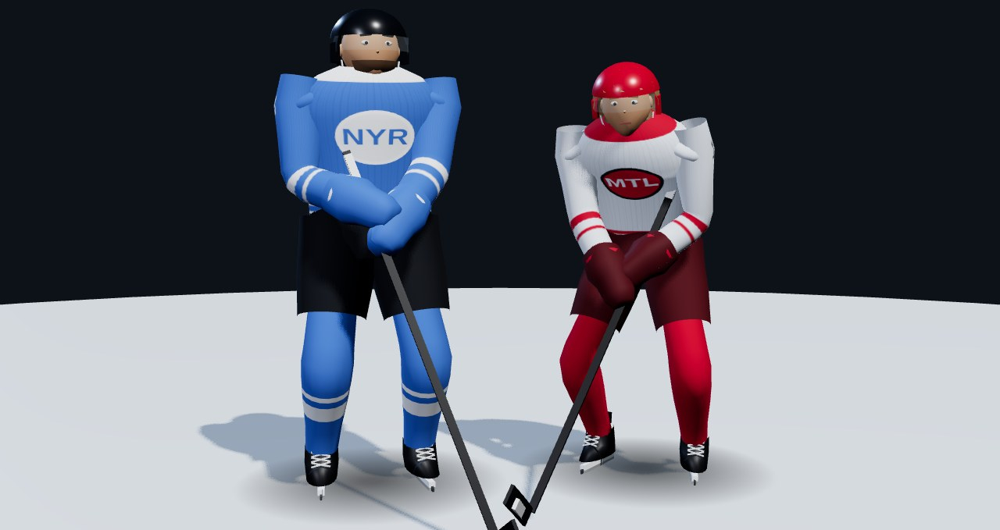
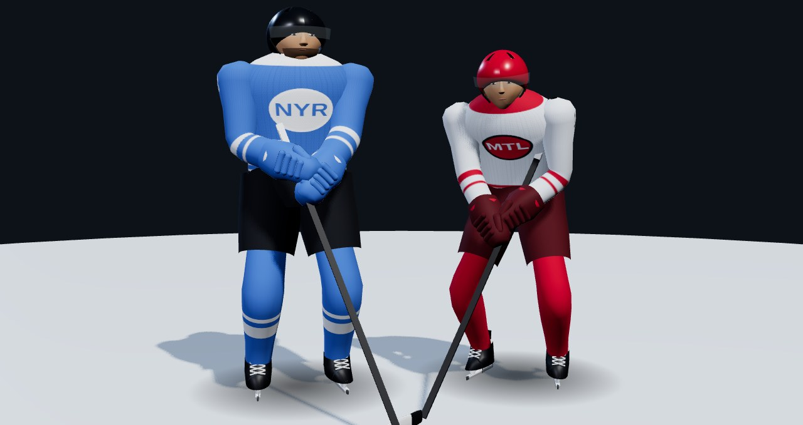
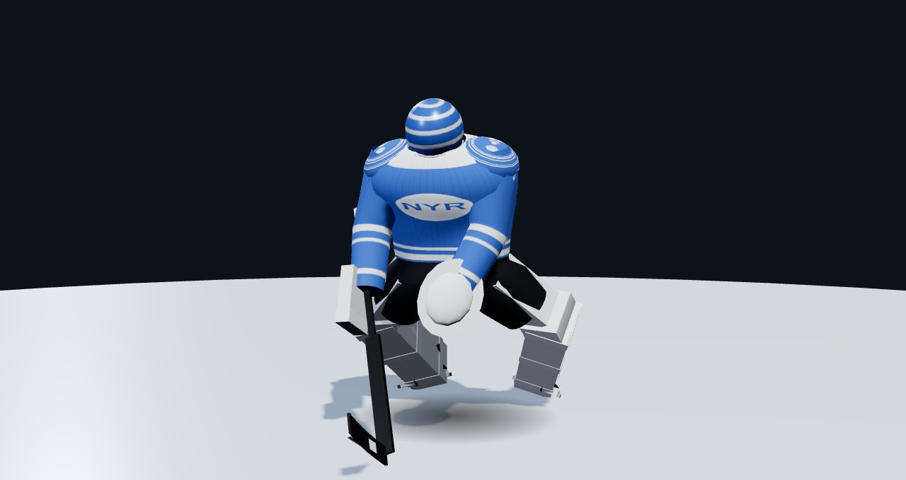
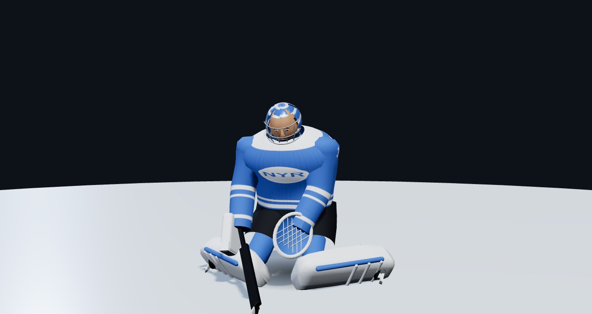

# Модели хоккеистов в NHL Manager 27

| Модель | Версия из main (9546918) | Версия из PR |
|---|---|---|
| Полевые игроки |  |  |
| Вратарь в баттерфляе |  |  |

Для сравнения обе версии сняты в одной студии при одинаковых камере, освещении, форме и времени анимации. Лица генерируются по ID. В этой среде браузер использовал клубные нашивки с аббревиатурами при недоступности внешних эмблем.

[Вид сбоку](after/model-side.jpg) · [Вид сзади](after/model-back.jpg) · [Катание](after/skating.jpg) · [Бросок](after/shot.jpg) · [Вбрасывание](after/faceoff.jpg) · [Празднование](after/goal-celebration.jpg) · [Состав](after/lineup.jpg) · [Матч](after/match.jpg)

| Геометрия одного персонажа | Крупный план | Основная камера | Дальний план |
|---|---:|---:|---:|
| Полевой игрок (Adam Fox) | 15 108 | 9 464 | 2 200 |
| Вратарь (Igor Shesterkin) | 15 588 | 9 780 | 3 247 |

## Как посмотреть в движении

Запустите `npm run dev` и откройте `/?demo=models`. Мышью или касанием можно вращать модель и менять масштаб. Селекторы управляют формой, телосложением, движением и детализацией. `/?demo=broadcast` открывает матч с обеими командами.

Для автономного просмотра выполните `npm run build:preview` или скачайте артефакт `hockey-character-review` из проверки PR. Откройте `NHL-Manager-27-model-lab.html` для студии или `NHL-Manager-27-broadcast-demo.html` для трансляции.

## Исходники и экспорт

Модели шлема, маски и решётки созданы в Blender. Их библиотека загружается из GLB на ближнем и среднем уровнях детализации. В игре экипировка объединяется с индивидуальной геометрией и привязывается к скелету. Игровое время определяет события, анимация получает готовые события от симуляции.

- [Сцена Blender](../../src/assets/headgear.blend) и [скрипт построения](../../scripts/build-headgear.py)
- [Карты материала трикотажа](../../src/assets) и [скрипт запекания](../../scripts/build-knit.py)
- [Экспортированные модели полевого игрока и вратаря](../../public/models/hockey) в файлах `skater-match.glb` и `goalie-match.glb`
- [Экспорт GLB с анимациями](../../scripts/export-characters.mjs) через работающий Vite-сервер

## Проверка трансляции

В headless Chromium при 1920 × 1080 с программным рендерером ANGLE/SwiftShader трансляция показала **0,2 FPS** на выборке из 30 кадров, 95-й процентиль времени кадра составил **14,48 с**. В матче на льду было 12 хоккеистов, в сцене отрисовывались также скамейки и трибуны. К концу замера автоматический режим уже отключил отражения и постобработку. Такой результат на программном рендерере непригоден для игры. Дискретная GPU в этой среде недоступна, целевые 60 FPS и загрузка физической GPU требуют отдельного замера.
